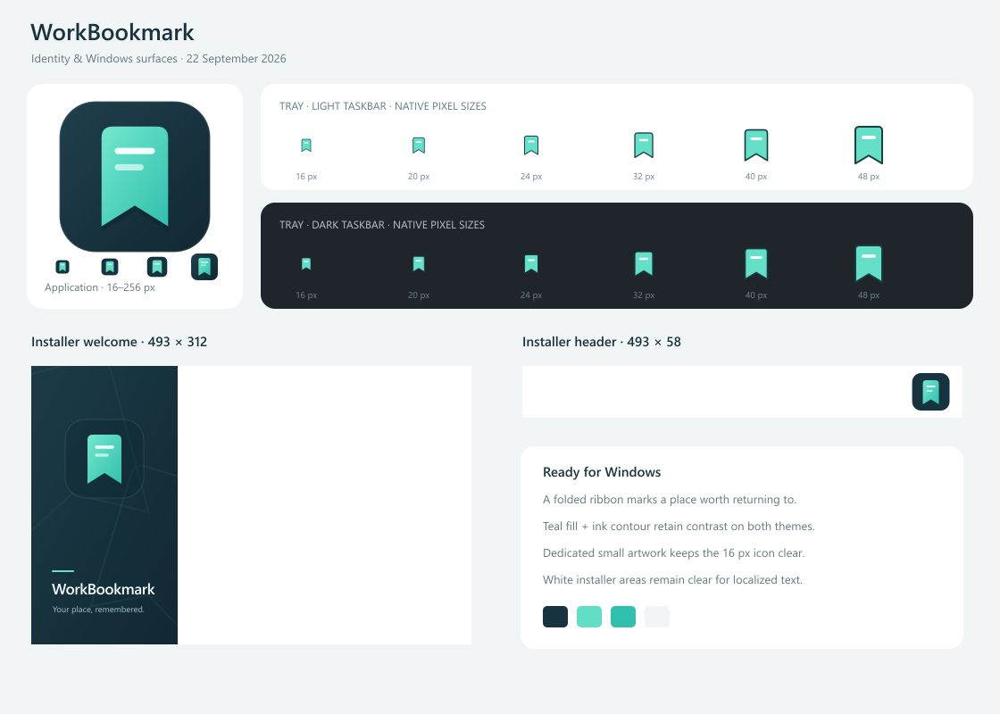

# 업무 책갈피 / WorkBookmark

Windows 탐색기·Excel·Word·PowerPoint·메모장의 작업 위치와 Edge·Chrome·네이버 Whale 웹페이지를 로컬에 남기는 트레이 도구입니다.

**0.2.20 · 정렬된 폴더 카드와 변경 되돌리기:** 폴더의 하위 항목을 공통 영역에 정렬하고, 주변 스티커를 밀지 않도록 변경했습니다. 각 항목은 둥근 모서리의 독립된 카드로 보이며, 카드 사이와 모서리 바깥은 배경이 보입니다. 공통 정렬·스크롤은 유지하고 클릭·드롭 범위는 실제 보이는 카드와 스크롤바에 맞춥니다. 실행 취소 범위를 넓히고, 서로 다른 화면 배율 사이의 이동과 한글 조합 후 자동저장을 보완했습니다.

사람의 직접 조작으로 폴더 묶기·이동·접기·분리·되돌리기, 100%↔125% 배율 이동, 루트와 자식의 한글 입력을 확인했습니다. 드래그 저장 실패 시 데이터 유지도 확인했습니다. 외형 변경 전후를 구분한 실기 범위는 [릴리스 안내](docs/release-notes-v0.2.20.md)에 기록합니다. 전체 자동검사·패키지 검사·게시 자산 대조의 최종 결과는 [0.2.20 릴리스](https://github.com/prozac0401/BookMark/releases/tag/v0.2.20)의 본문과 첨부 검증 자료를 기준으로 합니다. [0.2.19 실사용·배포 기록](docs/evidence/acceptance-0.2.19-2026-11-04/README.md)은 별도로 보존합니다.

**[0.2.20 MSI 다운로드](https://github.com/prozac0401/BookMark/releases/download/v0.2.20/WorkBookmark-0.2.20-win-x64.msi)** · [전체 배포 파일](https://github.com/prozac0401/BookMark/releases/tag/v0.2.20) · [변경 사항과 검증 범위](docs/release-notes-v0.2.20.md) · [설치 및 사용 매뉴얼](docs/user-manual.ko.md) · [빠른 시작](docs/quick-start.ko.md)

배포 파일 구성은 MSI·포터블 ZIP·Source.zip·SourceSnapshot.json·검증 JSON·SHA256SUMS.txt의 6종입니다. 패키지는 서명되지 않았습니다. 최종 MSI 검사 결과는 첨부 검증 JSON, 소스 기준은 SourceSnapshot.json, 파일 지문은 SHA256SUMS.txt에서 확인합니다. 실제 UI 조작·설치 시험과 자동검사의 범위는 [이번 릴리스 안내](docs/release-notes-v0.2.20.md)에 구분합니다.

링크 없는 폴더와 스티커·목록의 공통 구조를 유지합니다. **최상위 스티커(루트)의 위치와 트리 폭**을 조절하며, 하위 항목은 저장된 순서에 따라 배치됩니다. 하위 항목 사이의 삽입선은 순서·소속 변경, 폴더 가운데는 안으로 이동, 일반 항목 가운데의 묶기 영역은 새 폴더 생성입니다. 하위 항목을 빈 바탕화면에 놓으면 최상위로 꺼냅니다. 변경 전 데이터는 `.bak`으로 백업하고 **DB v9**로 이전합니다. [백업 안내](docs/user-manual.ko.md#maintenance)를 참고하세요.

일반 책갈피는 메모가 있으면 메모가 스티커 제목이 됩니다. 폴더 이름은 최대 **100자**, 메모는 최대 **500자**이며 다른 창으로 이동하면 자동 저장합니다. **Enter**로 바로 저장하거나 **취소 / Esc**로 되돌릴 수 있습니다. 기존 표시·숨김 토글, 자석 정렬, 한 줄 스티커와 0.2.10 메모 회귀 수정도 포함합니다.

이전 검증 기록은 [0.2.17 픽토그램·버튼 디자인](docs/release-notes-v0.2.17.md), [0.2.16 실선 테두리 제거·둥근 버튼](docs/release-notes-v0.2.16.md), [0.2.15](docs/release-notes-v0.2.15.md), [0.2.14](docs/release-notes-v0.2.14.md), [0.2.14-test.2](docs/release-notes-v0.2.14-test.2.md), [0.2.13](docs/release-notes-v0.2.13.md), [0.2.12](docs/release-notes-v0.2.12.md), [0.2.11](docs/release-notes-v0.2.11.md), [0.2.10](docs/release-notes-v0.2.10.md), [0.2.9](docs/release-notes-v0.2.9.md), [Whale 사용자 확인](docs/stable-release-20261005.md)에 보존합니다.



Windows 빌드·자동검사와 실제 환경별 확인 결과는 [검증 보고서](docs/validation-report.md)와 [호환성표](docs/compatibility.md)에 정리했습니다.

- Ctrl+Alt+B: 탐색기 폴더/단일 선택 항목, Excel 셀, Word 본문 위치, PowerPoint 슬라이드 기록
- 메모장: 새 문서·미저장 내용에서 Ctrl+Alt+B로 본문과 선택 위치 자동 보관. 재개 시 저장 당시 내용의 별도 복원본을 엽니다.
- Edge·Chrome·네이버 Whale: 확장 없이 Ctrl+Alt+B로 현재 페이지의 제목·URL 저장. 주소 확인이 제한된 화면은 트레이의 ‘웹페이지 URL로 추가…’ 사용. 기존 Edge·Chrome용 [브라우저 확장](browser-extension/README.md)은 선택 사항이며, Whale 확장 연결 등록은 이번 범위에 포함하지 않습니다.
- Ctrl+Alt+J: 스티커 모드에서는 전체 표시·숨기기 전환, 목록 모드에서는 목록 열기. 목록은 Enter, 스티커는 왼쪽 청록색 이동 버튼으로 저장 위치 재개
- 포스트잇 스티커: 제목 한 번 클릭으로 선택, 더블클릭 또는 F2 / Ctrl+E로 편집. 루트는 트리 전체를 이동하고 하위 항목은 삽입선·이동·묶기 영역으로 조작. Alt는 루트의 자석·묶기를 끄고 하위 항목 드래그는 취소
- 선택 메모, 검색, 현재 실행 세션의 마지막 변경 되돌리기, 최근 삭제 복원, 접근 실패 항목의 경로 재지정
- 사용자별 로컬 SQLite, 요청마다 별도 STA worker, 외부 전송 없음

[후속 구현 진행·결정 기록](docs/implementation-progress.md) · [한국어 사용 안내](docs/quick-start.ko.md) · [P0 검증](docs/feasibility-report.md) · [구현 결정](docs/decisions.md)

## 실행

**0.2.3 이하를 사용자 지정 경로에 설치했다면 기존 MSI와 원래 INSTALLFOLDER를 지정해 먼저 제거한 뒤 새로 설치하세요.** 기본 경로의 일반 업데이트는 이전 릴리스에서 확인했습니다. 이번 릴리스의 검증 범위는 위 릴리스 안내를 참고하세요. [설치 경로 이행 안내](docs/windows-installer.ko.md)를 먼저 확인하세요.

[0.2.20 릴리스](https://github.com/prozac0401/BookMark/releases/tag/v0.2.20)의 `WorkBookmark-0.2.20-win-x64.msi`는 기본 경로의 이전 MSI 설치를 자동 제거하고 현재 사용자에게 새 버전을 설치하는 방식입니다. 책갈피와 설정은 유지되며, 첫 실행 시 기존 DB를 백업한 뒤 v9로 이전합니다. 설치 완료 화면의 **업무 책갈피 실행**은 기본 선택되어 있으며, 바로 실행하지 않으려면 선택을 해제한 뒤 마칩니다. 시작 메뉴에서도 실행할 수 있습니다. Windows 로그인 시 자동 실행은 설정에서 끌 수 있습니다. 제어판 ‘프로그램 제거’ 또는 Windows ‘설치된 앱’에서 제거할 수 있으며 책갈피 데이터는 유지됩니다. 관리자 권한과 SDK 설치는 필요하지 않습니다.

**0.2.14-test.2 등 포터블 시험판이 실행 중이면 MSI 설치 전에 트레이 → 종료로 완전히 종료하세요.** 같은 Windows 사용자 계정에서는 `%LOCALAPPDATA%\WorkBookmark`의 기존 책갈피·설정을 이어서 사용합니다. 포터블 실행 폴더는 자동 제거하지 않습니다.

포터블 사용은 self-contained win-x64 ZIP을 **폴더 전체**로 압축 해제하고 `WorkBookmark.exe`를 실행합니다. 트레이 메뉴에서 종료할 수 있습니다.

새 루트 스티커의 기본 내용 영역은 100% 배율 기준 **260×36**, 최소 **240×36**입니다. 제목은 9.5pt 한 줄이며, 왼쪽 청록색 버튼은 저장 위치를 열고 폴더 버튼은 하위 항목을 펼치거나 접습니다. 폴더 제목 옆에는 자식 수를 표시합니다. **제목 한 번 클릭은 선택**, 더블클릭은 편집입니다. 위치·폭 조절은 루트에서 하고, 하위 카드의 폭은 루트의 실제 보이는 내용 폭에 맞춥니다. **Esc / 이 트리 숨기기**는 편집 중이 아닐 때 해당 항목이 속한 **트리 전체**를 숨깁니다.

스티커 모드에서 **Ctrl+Alt+J**는 하나라도 보이면 **모두 숨기고**, 모두 숨겨져 있으면 **모두 표시**합니다. 일부만 숨긴 상태에서는 첫 입력으로 나머지도 숨기고, 다시 누르면 전체를 표시합니다. 설정에서 **책갈피 보기** 단축키를 바꿨다면 바꾼 키도 같은 방식으로 동작합니다. **트레이 → 책갈피 보기**와 트레이 아이콘 더블클릭은 항상 전체 스티커를 표시하며, 목록 모드의 단축키는 목록을 엽니다.

**자석 정렬은 기본으로 켜져 있습니다.** 루트를 가까이 끌면 트리의 가장자리를 맞춥니다. 100% 배율에서 붙는 범위는 **12픽셀**, 간격은 **8픽셀**이며 화면 배율을 반영합니다. **Alt**를 누르면 루트는 자석·묶기 없이 이동하고, 하위 항목은 드래그를 취소합니다. 이동 중에는 미리보기만 표시하며 놓을 때 저장합니다. **트레이 → 스티커 위치 모으기 → 격자로 / 가로로 / 세로로 정렬**은 숨긴 트리까지 표시하여 마우스가 있는 모니터에 루트들을 배치합니다.

**폴더는 개별 둥근 카드로 펼쳐지며 주변 트리의 위치를 바꾸지 않습니다.** 하위 항목은 공통 영역에서 들여쓰기와 저장 순서대로 표시하고, 화면에 다 들어가지 않으면 함께 스크롤합니다. 실제 카드와 스크롤바만 뒤를 가리며, 카드 사이와 둥근 모서리 바깥은 배경이 보이고 클릭·드롭도 그 뒤의 보이는 대상을 따릅니다. 폴더 우클릭의 **원본 이름순 정렬 / 최근 저장순 정렬**은 한 번만 적용하며 이후 재캡처가 수동 순서를 바꾸지 않습니다. 원본 이름순은 메모로 바꾼 스티커 제목이 아니라 원래 책갈피 이름을 기준으로 합니다.

서로 다른 배율의 모니터로 옮길 때는 도착 화면의 배율과 공간을 반영한 미리보기를 표시합니다. 놓은 뒤에도 그 루트·패널 배치를 유지하며, 하위 항목의 순서와 주변 트리의 위치를 바꾸지 않습니다.

**목록에서 찾기**에서 항목을 끄는 동안 검색 결과가 갱신되어도 표시된 행을 유지합니다. 목록 위·아래 가장자리에 머무르면 스크롤하고, 드래그를 마치거나 취소하면 보류한 갱신을 반영합니다. 목록에서 **스티커에서 보기**를 선택하면 해당 항목의 조상을 펼치고 그 트리를 표시합니다.

0.2.6의 크기 이전 정책과 당시 사용자 지정 크기 보존 기록은 [이전 릴리스 안내](docs/release-notes-v0.2.6.md)에 남겨 둡니다. 0.2.20은 기존 루트의 위치·폭을 유지하고 높이는 한 줄 헤더로 표시합니다. 과거 높이를 포함한 저장 배치는 이전 전 백업에 보존되며, 선택한 목록/스티커 모드도 유지합니다.

스티커 모드로 실행하면 단축키를 누르기 전부터 스티커가 다른 일반 창 위에 나타납니다. **제목 더블클릭 / F2 / Ctrl+E**로 일반 책갈피의 메모나 폴더 이름을 편집합니다. **루트 편집은 기존 크기를 유지**하고, 하위 항목은 패널 안의 해당 행만 100% 배율 기준 **96픽셀**로 늘어납니다. 저장·취소 후 하위 행은 원래 높이로 돌아갑니다. **Enter** 또는 창 전환으로 저장하고 **취소 / Esc**로 편집을 취소합니다. 접기·숨기기·삭제·구조 이동 등에 앞서 편집을 저장하며, 저장 실패 시 작업을 중단하고 입력 내용을 유지합니다.

한글 조합 중 **Enter**는 글자를 확정하고, 다음 Enter가 메모를 저장합니다. 다른 창이나 형제 항목으로 이동할 때도 조합 결과가 반영된 뒤 자동저장하여 마지막 음절을 보존합니다.

편집을 마친 뒤 **Ctrl+Z / 마지막 변경 되돌리기**는 현재 실행 세션의 북마크 생성·재캡처, 내용·색상 변경, 그룹화·순서·소속, 루트 배치·크기, 삭제·복원을 완료한 역순으로 되돌립니다. 편집기 안에서는 글자 편집의 Ctrl+Z를 사용합니다. 펼침·숨김·스크롤·앞뒤 순서·자동 실행 기록은 제외하며, 앱을 재시작하면 실행 취소 이력은 초기화됩니다. 이미 저장된 데이터는 유지됩니다.

0.2.0은 데이터 형식을 v5로 갱신하고 변경 전 `.bak` 백업을 남깁니다. **0.1.7은 갱신된 DB를 읽을 수 없습니다.** 구버전 복귀에는 업그레이드 전 백업 복원이 필요합니다. [백업·업데이트 안내](docs/user-manual.ko.md#maintenance)를 확인하세요.

**0.2.20은 DB v9**를 사용합니다. 기존 DB를 처음 열 때 `bookmarks.db.pre-migration-….bak`을 만들고 기존 표시 순서를 형제 순서로 저장합니다. 기존 책갈피·메모·관계와 과거 하위 항목 좌표를 포함한 배치 기록은 보존하되, 새 하위 행은 공통 패널 규칙으로 표시합니다. **0.2.19는 v9 DB를 읽을 수 없으므로 이전 전 백업 없이는 복귀할 수 없습니다.** 복귀할 때는 현재 데이터 폴더를 별도로 보존한 뒤 백업의 복사본을 복원하며, 백업 이후 추가·수정한 기록은 포함되지 않습니다. 기존 자석 정렬 설정·보기 모드와 루트 위치·폭은 유지하고, 루트 높이는 한 줄 헤더로 표시합니다. 과거 높이는 이전 전 백업에 남습니다.

## 소스에서 빌드

Windows x64와 .NET SDK **10.0.401**이 필요합니다. 브라우저 확장 자동시험에는 Node.js가 필요하며, PATH에 없으면 build.ps1의 -NodePath로 실행 파일을 지정합니다. 설치되어 있지 않으면 `scripts/bootstrap-sdk.ps1`이 저장소의 `.tools/dotnet`에 공식 ZIP을 내려받고 SHA-512 확인 후 압축 해제합니다. 시스템 SDK를 바꾸지 않습니다.

```powershell
.\scripts\bootstrap-sdk.ps1
.\scripts\build.ps1 -Package -Msi
```

직접 실행 시:

```powershell
$dotnet = ".\.tools\dotnet\dotnet.exe"
& $dotnet restore WorkBookmark.sln --locked-mode --configfile NuGet.Config
& $dotnet build WorkBookmark.sln -c Release --no-restore
& $dotnet run --project tests/WorkBookmark.Core.Tests -c Release --no-build
& $dotnet run --project tests/WorkBookmark.Integration.Tests -c Release --no-build
& $dotnet publish src/WorkBookmark.App -c Release -r win-x64 --self-contained true --no-restore -o artifacts/publish/win-x64
```

배포 MSI·ZIP·Source.zip·SourceSnapshot.json·검증 JSON·SHA256SUMS.txt는 `artifacts/releases/<빌드시각>/`에 생성됩니다. MSI만 만들 때는 `scripts/build.ps1 -Msi`를 사용합니다. 기본 `Commit` 모드는 깨끗한 작업 트리의 Git HEAD로 Source.zip을 만듭니다. 아직 커밋하지 않은 수정까지 함께 배포하려면 `scripts/build.ps1 -Package -Msi -SourceMode WorkingTree`를 사용합니다. `SourceSnapshot.json`에 기준 커밋과 소스 모드를 기록합니다. 런타임/패키지는 lock 파일로 고정합니다. 자동시험은 Office 실기시험을 대신하지 않습니다.

## 구조

`Core`: DTO·경로 정책·IPC / `Storage`: SQLite / `Windows`: Shell·Office·실험 PDF / `App`: WinForms UI·수명 관리. `tools/Probes`와 `tools/WindowsChecks`는 합성 자료로 P0를 재현하는 개발용 도구이며 실행 ZIP에 포함하지 않습니다.

[확장 요구명세](docs/extension-requirements.md)와 [확장 검증 결과](docs/extension-validation.md)에 변경 범위와 근거를 기록했습니다. [GitHub 릴리스](https://github.com/prozac0401/BookMark/releases)에서 MSI·포터블 ZIP·소스·검증 파일과 이전 버전을 받을 수 있습니다.
