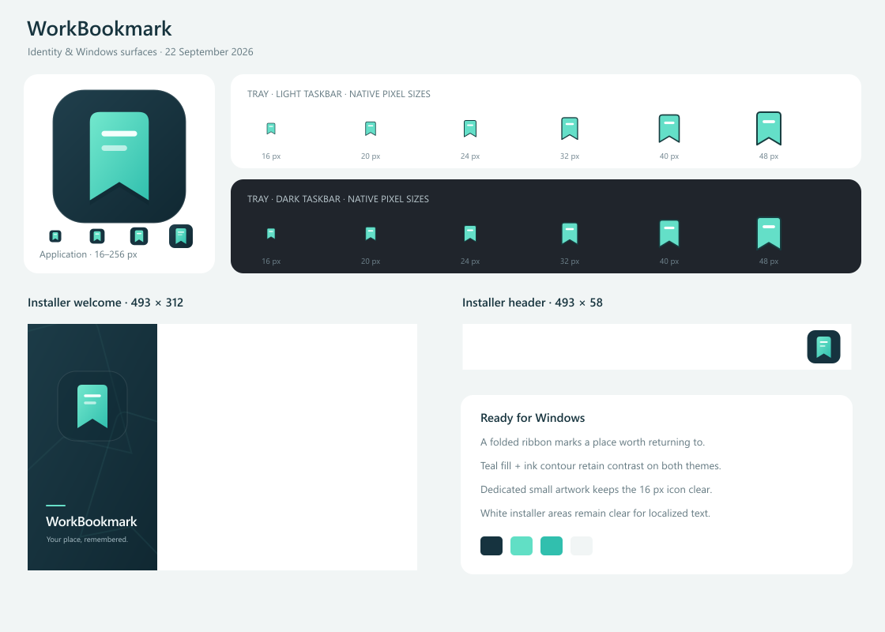

# 업무 책갈피 / WorkBookmark

Windows 탐색기·Excel·Word·PowerPoint·메모장의 작업 위치와 Edge·Chrome·네이버 Whale 웹페이지를 로컬에 남기는 트레이 도구입니다.

**0.2.17: 저장 위치로 돌아가는 버튼과 자식 스티커를 펼치는 버튼을 Microsoft Fluent 표준 픽토그램으로 구분했습니다.** 청록색 이동 버튼의 프레임·바깥 화살표는 **북마크 위치로 이동**, 차분한 남보라색 폴더 버튼의 폴더·방향 표시는 **자식 스티커 펼치기/접기**를 뜻합니다. 폴더가 닫혀 있으면 오른쪽, 펼쳐져 있으면 아래쪽을 가리키며 제목 옆에는 자식 수를 표시합니다. 아이콘과 둥근 배경은 고해상도로 그린 뒤 부드럽게 축소합니다. 36픽셀 한 줄 높이·28픽셀 버튼, 8-DIP 곡률과 테두리 없는 스티커를 유지합니다. 한 번 클릭으로 선택, 끌기로 이동, 더블클릭 또는 F2 / Ctrl+E로 편집하며, **Shift를 누른 채 끌어 놓을 때만 폴더로 묶습니다.**

**[0.2.17 MSI 다운로드](https://github.com/prozac0401/BookMark/releases/download/v0.2.17/WorkBookmark-0.2.17-win-x64.msi)** · [전체 배포 파일](https://github.com/prozac0401/BookMark/releases/tag/v0.2.17) · [변경 사항과 검증 범위](docs/release-notes-v0.2.17.md) · [설치 및 사용 매뉴얼](docs/user-manual.ko.md) · [빠른 시작](docs/quick-start.ko.md)

배포 파일은 MSI·포터블 ZIP·Source.zip·SourceSnapshot.json·검증 JSON·SHA256SUMS.txt의 6종입니다. 패키지는 서명되지 않았습니다. 최종 MSI 검사 결과는 첨부 검증 JSON, 소스 기준은 SourceSnapshot.json, 파일 지문은 SHA256SUMS.txt에서 확인합니다. 실제 UI 조작·설치 시험과 자동검사의 범위는 [이번 릴리스 안내](docs/release-notes-v0.2.17.md)에 구분합니다.

0.2.12에서 도입한 링크 없는 폴더를 계속 사용합니다. 스티커에서는 **Shift를 누른 채 B를 폴더 A 위로 끌어 놓으면 A 안으로 이동**하고, 일반 스티커 A 위에 놓으면 둘을 담는 새 폴더를 만듭니다. 일반 이동은 겹쳐 놓아도 폴더 관계를 바꾸지 않습니다. 스티커와 목록은 같은 구조·색상·열림 상태를 공유합니다. **0.2.17은 0.2.12의 DB v8을 그대로 사용하며 스키마 변경이 없습니다.** 0.2.11 이하의 DB는 `.bak` 백업 후 v8로 이전합니다. 0.2.11 이하로 복귀할 때는 이전 전 백업이 필요합니다. [백업 안내](docs/user-manual.ko.md#maintenance)를 참고하세요.

일반 책갈피는 메모가 있으면 메모가 스티커 제목이 됩니다. 폴더 이름은 최대 **100자**, 메모는 최대 **500자**이며 다른 창으로 이동하면 자동 저장합니다. **Enter**로 바로 저장하거나 **취소 / Esc**로 되돌릴 수 있습니다. 기존 표시·숨김 토글, 자석 정렬, 한 줄 스티커와 0.2.10 메모 회귀 수정도 포함합니다.

이전 검증 기록은 [0.2.16 실선 테두리 제거·둥근 버튼](docs/release-notes-v0.2.16.md), [0.2.15](docs/release-notes-v0.2.15.md), [0.2.14](docs/release-notes-v0.2.14.md), [0.2.14-test.2](docs/release-notes-v0.2.14-test.2.md), [0.2.13](docs/release-notes-v0.2.13.md), [0.2.12](docs/release-notes-v0.2.12.md), [0.2.11](docs/release-notes-v0.2.11.md), [0.2.10](docs/release-notes-v0.2.10.md), [0.2.9](docs/release-notes-v0.2.9.md), [Whale 사용자 확인](docs/stable-release-20261005.md)에 보존합니다.



Windows 빌드·자동검사와 실제 환경별 확인 결과는 [검증 보고서](docs/validation-report.md)와 [호환성표](docs/compatibility.md)에 정리했습니다.

- Ctrl+Alt+B: 탐색기 폴더/단일 선택 항목, Excel 셀, Word 본문 위치, PowerPoint 슬라이드 기록
- 메모장: 새 문서·미저장 내용에서 Ctrl+Alt+B로 본문과 선택 위치 자동 보관. 재개 시 저장 당시 내용의 별도 복원본을 엽니다.
- Edge·Chrome·네이버 Whale: 확장 없이 Ctrl+Alt+B로 현재 페이지의 제목·URL 저장. 주소 확인이 제한된 화면은 트레이의 ‘웹페이지 URL로 추가…’ 사용. 기존 Edge·Chrome용 [브라우저 확장](browser-extension/README.md)은 선택 사항이며, Whale 확장 연결 등록은 이번 범위에 포함하지 않습니다.
- Ctrl+Alt+J: 스티커 모드에서는 전체 표시·숨기기 전환, 목록 모드에서는 목록 열기. 목록은 Enter, 스티커는 왼쪽 청록색 이동 버튼으로 저장 위치 재개
- 포스트잇 스티커: 왼쪽 버튼과 제목을 한 줄로 표시. 제목 한 번 클릭으로 선택, 제목·배경 여백을 끌어 이동, 더블클릭 또는 F2 / Ctrl+E로 편집. 자석 정렬은 위치만 맞추고, Shift를 누른 채 끌어 놓으면 폴더로 묶기. 오른쪽 아래 손잡이로 크기 조절
- 선택 메모, 검색, 삭제/10초 연속 되돌리기, 최근 삭제 복원, 접근 실패 항목의 경로 재지정
- 사용자별 로컬 SQLite, 요청마다 별도 STA worker, 외부 전송 없음

[후속 구현 진행·결정 기록](docs/implementation-progress.md) · [한국어 사용 안내](docs/quick-start.ko.md) · [P0 검증](docs/feasibility-report.md) · [구현 결정](docs/decisions.md)

## 실행

**0.2.3 이하를 사용자 지정 경로에 설치했다면 기존 MSI와 원래 INSTALLFOLDER를 지정해 먼저 제거한 뒤 새로 설치하세요.** 기본 경로의 일반 업데이트는 이전 릴리스에서 확인했습니다. 이번 릴리스의 검증 범위는 위 릴리스 안내를 참고하세요. [설치 경로 이행 안내](docs/windows-installer.ko.md)를 먼저 확인하세요.

[0.2.17 릴리스](https://github.com/prozac0401/BookMark/releases/tag/v0.2.17)의 `WorkBookmark-0.2.17-win-x64.msi`는 기본 경로의 이전 MSI 설치를 자동 제거하고 현재 사용자에게 새 버전을 설치하는 방식입니다. 책갈피와 설정은 유지됩니다. 설치 완료 화면의 **업무 책갈피 실행**은 기본 선택되어 있으며, 바로 실행하지 않으려면 선택을 해제한 뒤 마칩니다. 시작 메뉴에서도 실행할 수 있습니다. Windows 로그인 시 자동 실행은 설정에서 끌 수 있습니다. 제어판 ‘프로그램 제거’ 또는 Windows ‘설치된 앱’에서 제거할 수 있으며 책갈피 데이터는 유지됩니다. 관리자 권한과 SDK 설치는 필요하지 않습니다.

**0.2.14-test.2 등 포터블 시험판이 실행 중이면 MSI 설치 전에 트레이 → 종료로 완전히 종료하세요.** 같은 Windows 사용자 계정에서는 `%LOCALAPPDATA%\WorkBookmark`의 기존 책갈피·설정을 이어서 사용합니다. 포터블 실행 폴더는 자동 제거하지 않습니다.

포터블 사용은 self-contained win-x64 ZIP을 **폴더 전체**로 압축 해제하고 `WorkBookmark.exe`를 실행합니다. 트레이 메뉴에서 종료할 수 있습니다.

새 스티커의 기본 내용 영역은 100% 배율 기준 **260×36**, 최소 **240×36**입니다. 제목은 9.5pt 한 줄로 표시하고 왼쪽에 Windows 11 스티커와 같은 8-DIP 곡률의 둥근 28×28 버튼을 둡니다. 일반 책갈피는 청록색 배경의 **북마크 위치로 이동** 버튼을, 폴더는 남보라색 계열의 **자식 스티커 펼치기/접기** 버튼을 사용합니다. 버튼에 마우스를 올리면 해당 동작을 글로 확인할 수 있습니다. 폴더 제목 옆에는 자식 수를 표시합니다. Windows 제목줄·종류 아이콘·접기·지우기 버튼은 표시하지 않습니다. **제목을 한 번 클릭하면 선택**합니다. 선택하거나 이동할 때도 네모난 실선 테두리는 표시하지 않습니다. **제목이나 배경 여백을 끌어 이동**하고, **오른쪽 아래 크기 조절 손잡이**나 창 가장자리·모서리로 크기를 바꿉니다. 접힌 스티커의 손잡이는 가로 폭만 조절합니다. **우클릭 메뉴**에서 접기·지우기·숨기기 등을 사용합니다. **Esc**는 편집 중이 아닐 때 해당 스티커만 잠시 숨깁니다.

스티커 모드에서 **Ctrl+Alt+J**는 하나라도 보이면 **모두 숨기고**, 모두 숨겨져 있으면 **모두 표시**합니다. 일부만 숨긴 상태에서는 첫 입력으로 나머지도 숨기고, 다시 누르면 전체를 표시합니다. 설정에서 **책갈피 보기** 단축키를 바꿨다면 바꾼 키도 같은 방식으로 동작합니다. **트레이 → 책갈피 보기**와 트레이 아이콘 더블클릭은 항상 전체 스티커를 표시하며, 목록 모드의 단축키는 목록을 엽니다.

**자석 정렬은 기본으로 켜져 있습니다.** 보이는 주변 스티커에 가까이 끌면 가장자리와 행·열을 맞춥니다. 100% 배율에서 붙는 범위는 **12픽셀**, 나란히 둘 때 간격은 **8픽셀**이며 화면 배율을 반영합니다. **설정 → 스티커 자석 정렬**을 끄면 자유롭게 이동합니다. 두 모드 모두 **Alt**를 누른 동안 자유 이동하며 폴더로 묶지 않습니다. 폴더에 넣거나 새 폴더로 묶으려면 **Shift를 누른 채 대상 위로 끌어 놓습니다**. 묶을 수 있는 대상은 테두리 없이 배경색으로 표시합니다. Shift와 Alt를 함께 누르면 묶지 않습니다. **트레이 → 스티커 위치 모으기 → 격자로 / 가로로 / 세로로 정렬**은 숨긴 스티커까지 표시하여 마우스가 있는 모니터에 배치합니다. 이동·정렬한 위치는 저장됩니다.

0.2.6에서 기본 내용 크기 260×88을 쓰던 스티커만 한 줄 기본 크기로 줄입니다. 화면 배율을 반영한 저장 크기를 기준으로 기존 기본 크기를 판별합니다. 사용자가 조절한 크기와 선택한 목록/스티커 모드는 유지합니다. 표시 규칙을 한 번도 적용하지 않은 이전 설정은 기존 최초 적용 정책에 따라 스티커 모드와 새 기본 크기를 사용합니다. 위치·모니터·접힘과 삭제된 항목의 배치도 보존합니다.

스티커 모드로 실행하면 단축키를 누르기 전부터 스티커가 다른 일반 창 위에 나타납니다. 고정·해제 버튼은 없으며, **제목을 더블클릭**하거나 선택 후 **F2 / Ctrl+E**를 누르면 그 스티커 안에 입력칸이 열립니다. 폴더는 이름을, 일반 책갈피는 메모를 편집합니다. 메모가 없어 URL·주소·파일명이 보일 때도 같은 방식으로 편집합니다. 편집할 때 폭은 유지하고, 내용 높이가 100% 배율 기준 **96픽셀**보다 작으면 그 높이로 잠시 늘립니다. **저장 성공·취소 후에는 편집 직전 크기·접힘 상태로 돌아갑니다.** 단, 편집 중 직접 조절한 폭은 유지하고, 높이를 직접 바꿨다면 새 높이와 펼침 상태를 유지합니다. 화면 안쪽으로 자동 보정한 위치는 복구하고, 직접 이동하거나 일괄 정렬한 위치는 유지합니다. 다른 창으로 이동해 자동 저장해도 같습니다. 저장 버튼은 없습니다. **Enter**로 바로 저장하거나 저장 전에 **취소 / Esc**로 편집을 취소할 수 있습니다. 저장하지 못하면 입력한 글과 편집 영역이 남으므로 **Enter**를 누르거나 다른 창으로 다시 이동해 재시도하세요. 자세한 사용법은 [사용 매뉴얼](docs/user-manual.ko.md)을 참고하세요.

0.2.0은 데이터 형식을 v5로 갱신하고 변경 전 `.bak` 백업을 남깁니다. **0.1.7은 갱신된 DB를 읽을 수 없습니다.** 구버전 복귀에는 업그레이드 전 백업 복원이 필요합니다. [백업·업데이트 안내](docs/user-manual.ko.md#maintenance)를 확인하세요.

0.2.12부터 폴더·열림 상태·색상 저장에 DB v8을 사용하며, 0.2.17에는 스키마 변경이 없습니다. 0.2.11의 v7 DB, 0.2.0~0.2.10의 v5 DB와 트리 개발 단계의 v6 DB에서 갱신할 수 있습니다. 0.2.9에서 추가한 자석 정렬 선택 항목 `StickerSnapEnabled`를 유지하며, 항목이 없는 기존 설정은 기본값인 켜짐으로 읽습니다. 설정 파일 버전과 표시 규칙 버전은 유지하고, 0.2.5 이후 선택한 모드와 사용자 크기를 다시 초기화하지 않습니다.

## 소스에서 빌드

Windows x64와 .NET SDK **10.0.401**이 필요합니다. 브라우저 확장 자동시험에는 Node.js가 필요하며, PATH에 없으면 build.ps1의 -NodePath로 실행 파일을 지정합니다. 설치되어 있지 않으면 `scripts/bootstrap-sdk.ps1`이 저장소의 `.tools/dotnet`에 공식 ZIP을 내려받고 SHA-512 확인 후 압축 해제합니다. 시스템 SDK를 바꾸지 않습니다.

```powershell
.\scripts\bootstrap-sdk.ps1
.\scripts\build.ps1 -Package -Msi
```

직접 실행 시:

```powershell
$dotnet = ".\.tools\dotnet\dotnet.exe"
& $dotnet restore WorkBookmark.sln --locked-mode --configfile NuGet.Config
& $dotnet build WorkBookmark.sln -c Release --no-restore
& $dotnet run --project tests/WorkBookmark.Core.Tests -c Release --no-build
& $dotnet run --project tests/WorkBookmark.Integration.Tests -c Release --no-build
& $dotnet publish src/WorkBookmark.App -c Release -r win-x64 --self-contained true --no-restore -o artifacts/publish/win-x64
```

배포 MSI·ZIP·Source.zip·검증 JSON·SHA256SUMS.txt는 `artifacts/releases/<빌드시각>/`에 생성됩니다. MSI만 만들 때는 `scripts/build.ps1 -Msi`를 사용합니다. 기본 `Commit` 모드는 깨끗한 작업 트리의 Git HEAD로 Source.zip을 만듭니다. 아직 커밋하지 않은 수정까지 함께 배포하려면 `scripts/build.ps1 -Package -Msi -SourceMode WorkingTree`를 사용합니다. `SourceSnapshot.json`에 기준 커밋과 소스 모드를 기록합니다. 런타임/패키지는 lock 파일로 고정합니다. 자동시험은 Office 실기시험을 대신하지 않습니다.

## 구조

`Core`: DTO·경로 정책·IPC / `Storage`: SQLite / `Windows`: Shell·Office·실험 PDF / `App`: WinForms UI·수명 관리. `tools/Probes`와 `tools/WindowsChecks`는 합성 자료로 P0를 재현하는 개발용 도구이며 실행 ZIP에 포함하지 않습니다.

[확장 요구명세](docs/extension-requirements.md)와 [확장 검증 결과](docs/extension-validation.md)에 변경 범위와 근거를 기록했습니다. [GitHub 릴리스](https://github.com/prozac0401/BookMark/releases)에서 MSI·포터블 ZIP·소스·검증 파일과 이전 버전을 받을 수 있습니다.
