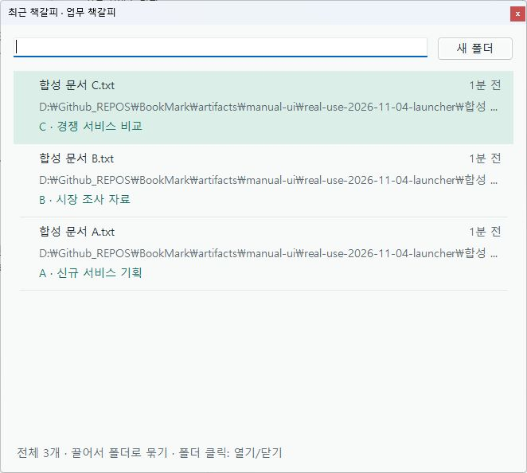

# 현재 개발본 실사용 검증 — 2026-11-04

**판정: 자동 회귀검사는 최종 각 실행 기준 1,127개 통과. 실제 입력을 포함한 실사용 인수는 보류합니다.** 실제 제품 목록 화면은 확인했으나, 입력 도구가 제품 창을 독립 조작 대상으로 제공하지 않아 스티커/목록 드래그와 메모 입력을 완료하지 못했습니다. 최초 IPC 일반 요청 실패 3건의 원인도 확정하지 못했습니다.

대상은 HEAD `843e75e`에 기존 미커밋 수정(일반 드래그 폴더 묶기·트리 배치·목록 갱신 보류)을 포함한 작업 트리입니다. 버전 문자열은 0.2.18이지만 기존 배포 MSI의 시험 결과가 아닙니다. Windows 11 build 22631, .NET SDK 10.0.401에서 실행했습니다. [환경](automated-environment.json) · [제품 바이너리 지문](build-sha256.json).

## 실행 결과

| 범위 | 최종 결과 | 근거 |
|---|---:|---|
| Locked restore / Release solution build | 성공, 경고 0·오류 0 | [복원](restore.log), [빌드](build-release.log) |
| Core / Storage | 76 | [로그](core-storage.log) |
| IPC | 17 | [하네스 수정 후 로그](integration-ipc-harness-fixed.log), [검사별 시간](integration-ipc-harness-fixed-results.json) |
| Desktop 구성요소·실제 임시 SQLite | 708 | [apphost 실행](desktop-apphost.log) |
| Windows adapter | 10 | [로그](adapter-checks.log) |
| Excel evidence / capture session 판정 | 13 / 14 | [evidence](evidence-selftest.log), [session](session-selftest.log) |
| Word / Office URL | 24 / 103 | [Word](word-checks.log), [Office URL](office-url-checks.log) |
| Browser adapter / native host / SQLite | 34 / 27 / 15 | [adapter](browser-checks.log), [host](browser-native-host.log), [SQLite](browser-sqlite.log) |
| Notepad / PDF transport | 28 / 28 | [Notepad](notepad-checks.log), [PDF](pdf-checks.log) |
| Browser extension / registration mock | 23 / 7 | [extension](browser-extension.log), [registration](browser-registration.log) |
| 중복 재실행을 제외한 합계 | **1,127** | [전체 요약](summary.json) |

이는 한 번의 무실패 전체 실행 결과가 아니라 **각 suite의 최종 결과 합계**입니다. 최초 실패도 아래에 보존합니다. Desktop 결과에는 합성 네이티브 이동 메시지와 private handler 호출이 포함되므로 실제 마우스 조작 성공으로 해석하지 않습니다. Office·탐색기·설치 브라우저·메모장 실기, MSI 설치/업데이트, 혼합 DPI·다중 모니터 이동, 한글 IME는 미검증입니다.

## 발견한 문제와 수정

1. **IPC 시험 하네스의 임시 PID 파일 정리 경쟁.** 추가 확인에서 D06이 `.pid.pending` 파일 공유 위반으로 실패했습니다. 종료 요청 직후 파일 핸들이 해제되기 전에 정리할 수 있었습니다. [실패 로그](integration-ipc-confirmation.log)를 보존하고 `tests/WorkBookmark.Integration.Tests/Program.cs`에서 공유/잠금 위반에만 최대 2초 재시도, 확인된 합성 자식 프로세스의 종료 대기, 실패 시 경과시간 기록을 추가했습니다. 두 프로세스를 시작하는 child-survives fixture는 기존 일반 요청과 같은 3초를 사용합니다. timeout 및 자식 생존 assertion은 유지했고 **제품 WorkerClient나 제품 시간 제한은 변경하지 않았습니다.** Integration.Tests만 다시 빌드한 뒤 17/17 통과했습니다.
2. **최초 IPC 실패의 원인은 일부 미확정.** 병렬 실행 13/17 → 다른 자동 suite 종료 후 17/17 → 추가 확인 16/17 → 하네스 수정 후 17/17입니다. 최초 valid-result-id는 CaptureTimedOut였으며 wrong-id와 Office capture는 기대 결과 불일치였습니다. 마지막 두 항목의 실제 응답 코드는 최초 로그에 없어 stale ID 수락이나 timeout으로 단정하지 않습니다. 최초 세 일반 요청 실패를 위 정리 경쟁으로 설명할 수 없습니다. [최초 로그](integration-ipc.log), [첫 재검사](integration-ipc-sequential-rerun.log), [이력과 한계](automated-suite-summary.json).
3. **검사 실행 방식 오류를 별도 제외.** 최초 Desktop를 `dotnet WorkBookmark.Desktop.Tests.dll`로 시작하여 SO04에서 실패했습니다. 자기 실행 경로가 `dotnet.exe`가 되어 합성 worker 인수가 잘못 전달되는 방식입니다. [잘못된 실행 로그](desktop.log)를 보존했으며, 문서화된 apphost EXE로 실행한 708개 통과만 집계했습니다.

## 실제 UI 시도와 차단 원인

실제 사용자 DB 대신 `artifacts/manual-ui/real-use-2026-11-04-*`의 합성 SQLite를 사용했습니다. 호스트가 로드한 제품 DLL과 worker DLL의 해시가 일치합니다. 제품 창 스타일과 소유 관계를 변경하지 않았습니다.

- 셸에서 실행한 기존 실기 호스트는 제어창과 스티커 3개가 `Visible=true`였지만 Sky 및 CUA 창 목록에 나타나지 않았습니다. [관찰 상태](native-state-shell.json), [창 열거](native-inventory-shell.json). 상태를 저장한 후 이 작업에서 생성한 호스트만 종료했습니다.
- 입력 도구의 직접 실행을 위해 인수 없는 self-contained WinExe 런처를 로컬 `artifacts/real-use-2026-11-04/launcher/publish/WorkBookmark.RealUseLauncher.exe`에 만들었습니다. 기존 `ManualTreeColorsAcceptance.Run`을 호출할 뿐, 테스트 동작이나 입력을 대신하지 않습니다. 직접 실행 요청은 timeout을 반환했지만 이후 창 열거와 프로세스 확인으로 실행 성공을 확인했습니다.
- 제어창의 **실제 목록 열기**를 화면 좌표로 클릭하여 실제 `RecentForm`과 합성 책갈피 3개를 확인했습니다. 목록은 제어창 스크린샷의 관련 영역으로 보였지만 독립 Window 항목으로 열거되지 않았습니다.
- 목록의 B를 A에 끌어 놓으려 하자 입력 도구가 바인딩된 제어창을 활성화했습니다. 제품 목록은 포커스를 잃고 숨겨져 입력이 비대상 창 위라는 오류로 거절됐습니다. 따라서 **목록 드래그는 BLOCKED, 스티커 드래그·폴더 생성·실제 메모 입력·자동저장은 NOT RUN**입니다. 제어창 클릭이나 화면 표시만으로 해당 동작을 통과 처리하지 않았습니다.
- 제어창의 정상 종료 버튼으로 런처를 종료했고 exit 스냅샷 및 프로세스 종료를 확인했습니다. [전체 입력 시도 판정](native-input-result.json), [호스트 관찰](native-state-launcher.json), [정상 종료 상태](native-state-launcher-exit.json).



## 남은 실사용 인수 항목

| 항목 | 확인할 결과 |
|---|---|
| B를 A 위로 일반 드래그 | 대상 강조 → 새 폴더 → 펼친 자식 2개 → 재시작 후 관계 유지 |
| Alt 이동 / 드래그 Esc 취소 | 폴더 관계가 바뀌지 않고 위치 정책대로 복구 |
| 인접한 폴더 2개 펼침·접기 | 먼저 연 트리 유지, 임시로 옮긴 주변 스티커 원위치 복구 |
| 20~30개 목록의 가장자리 드래그 | 300ms 대기 후 120ms마다 한 행 이동, 가운데/취소에서 정지 |
| 한글 메모 편집 | 더블클릭/F2, IME 입력, 포커스 이동 자동저장, Esc 취소, 실패 후 재시도 |
| 캡처·재개·표시/숨김·삭제/복원 | 실제 단축키와 대상 앱에서 확인, 재시작 후 보존 |

현재 실제 제품 창을 대상으로 입력할 수 있는 환경 또는 사람의 수동 조작이 필요합니다. 기존 실기 호스트를 직접 실행하는 명령은 아래와 같습니다. 기존 WorkBookmark를 정상 종료하고 저장소 루트에서 실행합니다.

```powershell
$env:DOTNET_ROOT = (Resolve-Path .tools/dotnet).Path
& ./tests/WorkBookmark.Desktop.Tests/bin/Release/net10.0-windows/WorkBookmark.Desktop.Tests.exe --manual-tree-colors ./artifacts/manual-ui/real-use-next ./src/WorkBookmark.App/bin/Release/net10.0-windows/win-x64/WorkBookmark.exe
```

이 호스트의 `bookmarks/rows` JSON은 최초 씨앗 3개만 조회합니다. 새로 만든 폴더는 `windows.bookmark` 또는 실제 합성 DB를 함께 확인해야 합니다. 실제 트레이의 설정 적용은 테스트 호스트 실행 경로를 사용하므로 설치된 제품 설정 적용의 증거로 쓰지 않습니다. MSI·ZIP·릴리스는 갱신하지 않았습니다.
